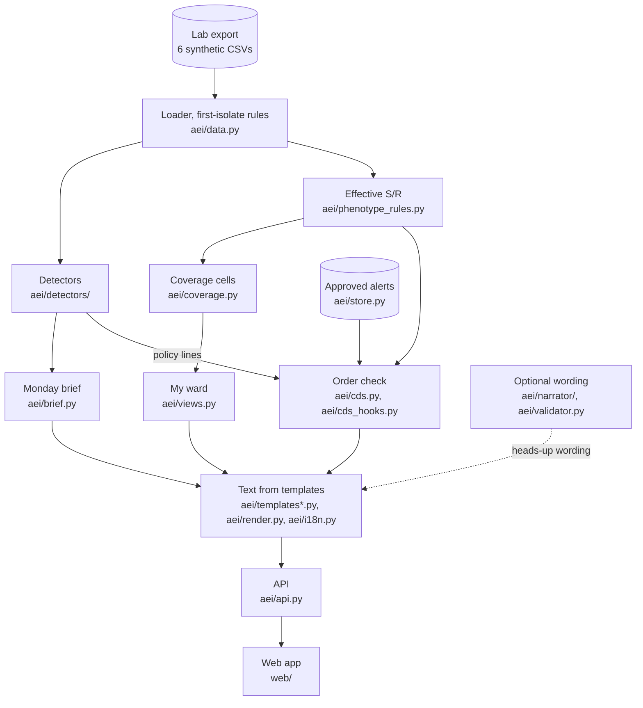

# Architecture

One Python package (`aei/`) turns a lab export into three views: the Monday brief, My ward and an order check. A
FastAPI app serves them as JSON and a static web app (`web/`) renders them. Specification: [CONTRACTS.md](CONTRACTS.md).

## Data flow

| Box | Where |
|---|---|
| Lab export | The challenge's synthetic CSVs, found via [aei/config.py](aei/config.py); never in git |
| Loader | [aei/data.py](aei/data.py): one row per isolate, date windows, the README and 30-day first-isolate rules |
| Effective S/R | [aei/phenotype_rules.py](aei/phenotype_rules.py): EUCAST and local rules, first match wins |
| Detectors | [aei/detectors/](aei/detectors/): a registry plus one module per detector, each `detect(ds, as_of)` |
| Coverage cells | [aei/coverage.py](aei/coverage.py), [aei/aggregates.py](aei/aggregates.py): R of n, interval, state |
| Monday brief | [aei/brief.py](aei/brief.py): sections, new/ongoing/resolved status, unit map, case-file rows |
| My ward | [aei/views.py](aei/views.py): last 4 weeks next to 52 weeks, filters, trends |
| Order check | [aei/cds.py](aei/cds.py) (pure rules), [aei/cds_hooks.py](aei/cds_hooks.py) (CDS Hooks 2.0 cards) |
| Text | [aei/templates.py](aei/templates.py) and siblings, [aei/render.py](aei/render.py), [aei/i18n.py](aei/i18n.py) |
| Optional wording | [aei/narrator/](aei/narrator/), [aei/validator.py](aei/validator.py) |
| Approved alerts | [aei/store.py](aei/store.py): SQLite demo state per session; infection control's approvals |
| API | [aei/api.py](aei/api.py) (endpoints and guards), [aei/precompute.py](aei/precompute.py) (cache warm-up) |
| Web app | [web/](web/): plain HTML, CSS and ES modules, no build step |

## Time model
- Every screen takes one `as_of`: the last data day, a Sunday. The brief is dated the Monday after. The replay slider
  moves `as_of` one week at a time, and all three views read the same value, so they always agree.
- **Strict as-of:** nothing sampled after `as_of` changes any number, signal or banner for that date. An alert approved
  later is invisible at earlier dates. Tests check this per layer (`test_data`, `test_brief`, `test_cds`, `test_api`).
- Windows end on `as_of` inclusive (28, 112, 364 days: "Last 4 / 16 / 52 weeks"). Dates are **sample dates**; results
  usually arrive about 2 days later (`config.RESULT_LAG_DAYS`), and the screens say so where lead time is shown.

## Why statistics and rules, not prediction
- The users need observed facts with honest uncertainty: what changed on a unit, against its own history and the
  hospital. A patient-level prediction would be harder to check and would make the tool medical-device software.
- Each detector is a small, named test or rule: shared-antibiogram clusters with a rarity gate (binomial), THL rules
  for CPE, VRE, ESBL and MRSA, a Bayes-factor count step-up, a beta-binomial change against the unit's prior 52 weeks,
  ward outliers, policy lines, "seen before" profile matches, expert-rule lab checks and silent units. Thresholds are
  constants in [aei/config.py](aei/config.py) or the detector module, whose docstring states the method.
- Every item carries its evidence (a re-runnable filter, counts, method, parameters) and plain wording: "possible
  cluster", "typing advised", "profile match, not typing"; never "predicts", "best choice" or "outbreak confirmed".

## How numbers stay honest
- **Slots:** a text is a template plus slots. Only code formats numbers ([aei/render.py](aei/render.py): half-up
  rounding, never "0%" or "100%" for a share that is not). Tests assert that no template holds a literal digit and
  that every digit in the brief (English and Finnish) and the Finnish order texts comes from a slot.
- **Small n:** below 10 isolates no percentage is shown ("not enough data"); 10 to 29 is labelled small n and uses a
  stabilised estimate; from 30 the observed share with its Jeffreys interval. The observed R of n is always shown.
- **Validator:** model output is checked before and after rendering ([aei/validator.py](aei/validator.py)).
- **Source-pinned tests:** [tests/test_against_source.py](tests/test_against_source.py) re-derives the headline demo
  numbers from the raw CSVs with plain pandas, without `aei` code, and requires the product to match.

## The optional language model
- Claude may word one thing: the drafted heads-up to the emergency department. Detection, every number and the order
  check are deterministic; `cds.py` never imports the narrator (a test enforces it).
- The model writes a skeleton with `{slot}` placeholders and no numbers or number words. The validator checks it, code
  fills in the numbers, and the result is checked again. Any failure, refusal or cap falls back to the template.
- It sees computed slots only (labels, counts, dates). A slot that looks like a patient or isolate id stops the call.
- Modes (`AEI_NARRATOR`): `template` (local default), `replay` (public default: recorded wording, no network) and
  `anthropic` (live, with a daily spend cap and per-IP limits). Without a key it makes no calls at all.

## Languages
- English by default, Finnish with `?lang=fi` on every endpoint that returns text. Every template id has a Finnish
  twin with the same slots ([aei/templates_fi.py](aei/templates_fi.py)), and numbers and dates follow the language
  ("20,4 %", "29.3.2026"). Signals are computed once and re-rendered, so a language never changes a number. The web
  app keeps its own words in `web/js/strings/`.

## Security and privacy
- **Sessions:** no login. The browser sends a random `X-Demo-Session` id; approvals, heads-ups and feedback are stored
  per session (plus shared demo seeds), with a write cap. No user id, patient id or IP address is stored.
- **Logs and exposure:** no access log, bodies or query strings in logs (errors by path only). `X-Robots-Tag: noindex,
  nofollow` on every response, `robots.txt` disallows all, no CORS, no trackers.
- **Limits:** per-IP rate limits, request bodies up to 64 KB, pydantic models on every write. The UI inserts API text
  as text only (lint bans `innerHTML`). Keys come from the environment and are never returned.
- **Data:** synthetic only, never committed or offered for download; mounted read-only in a non-root container.

## How it fits a hospital today
- It runs on the microbiology results the laboratory already produces, through a nightly extract from My+. In this
  repo the synthetic CSVs stand in for that extract.
- The Monday brief and My ward need no new law, no Findata permit and no change to the patient record system.
- Patient data stays inside the hospital's own environment or its existing lab system.
- Nothing is sent automatically. Infection control approves every alert, and the doctor makes every decision.
- The order check is built to the HL7 CDS Hooks standard (`/cds-services`, order-select and order-sign) for patient
  record systems that support it; it is simulated here and no EHR is connected. At Tyks it starts as a unit check page
  and a link from the patient record.
- Patient-specific warnings come later, built by the hospital under the EU in-house medical-device rule. The
  prototype's warning from the patient's own earlier resistant result shows that later stage.
- It starts with a back-test on historical data before anyone acts on the output.
