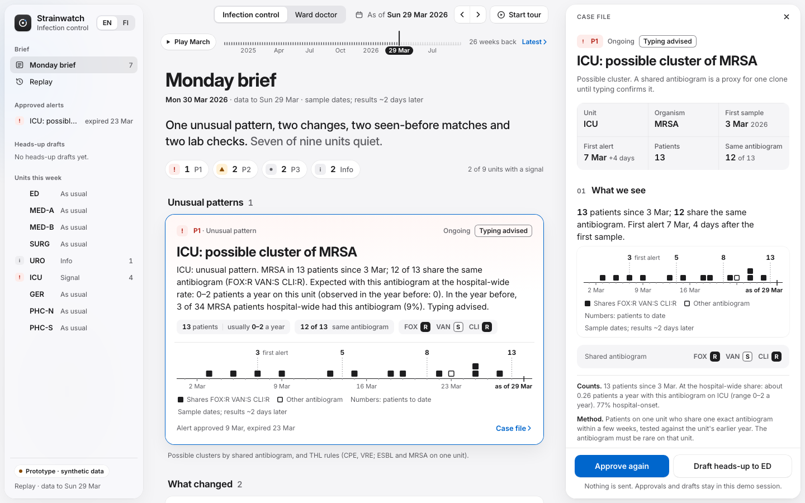
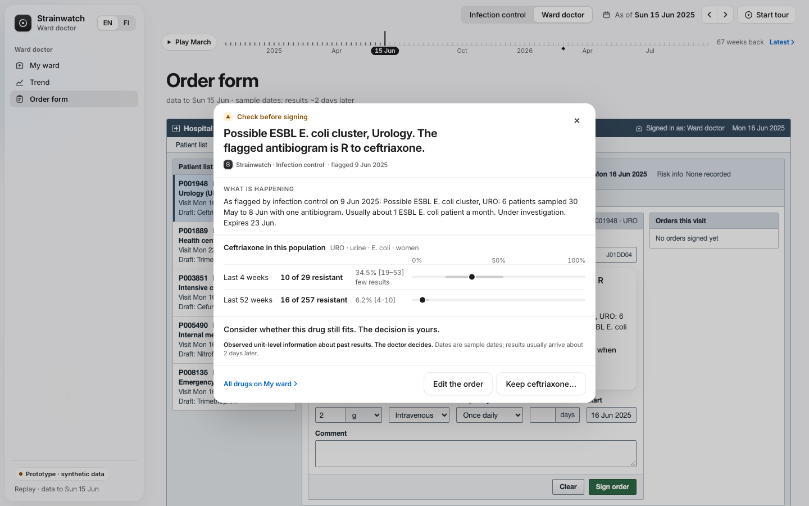

# Strainwatch

Weekly antibiotic-resistance surveillance for one hospital, on the Tyks x Mylab challenge data (JunctionX Turku 2026):
a Monday brief for infection control, My ward for ward doctors, and an order check that flags the drug being ordered.





Live demo: https://strainwatch.87-58-146-191.sslip.io (synthetic data; hosted in Helsinki)

## Run it
Python 3.12 on macOS or Linux, with the challenge's `synthetic_microbiology_dataset.zip`:
```bash
python3.12 -m venv .venv
.venv/bin/pip install -r requirements.txt
unzip -j synthetic_microbiology_dataset.zip '*.csv' -d data
.venv/bin/uvicorn aei.api:app --host 127.0.0.1 --port 8765
```
Open http://127.0.0.1:8765. The app reads the 6 synthetic CSVs from `data/` (gitignored), or from the folder in
`AEI_DATA_DIR`. Without them the server still starts and `/api/health` reports `"data_loaded": false`.
Optional: `.venv/bin/python -m aei.precompute` (under a minute) fills the replay slider's weekly counts. No API key is
needed: texts come from fixed templates.

## Architecture
- **Data:** [aei/data.py](aei/data.py) loads the lab export into one isolate table with first-isolate rules, and
  [aei/phenotype_rules.py](aei/phenotype_rules.py) decides the effective S/R for each isolate and drug.
- **Detection:** nine detectors in [aei/detectors/](aei/detectors/) (statistical tests and THL/EUCAST rules) feed the
  Monday brief ([aei/brief.py](aei/brief.py)); My ward ([aei/views.py](aei/views.py)) shows R of n with intervals.
- **Order check:** [aei/cds.py](aei/cds.py) decides with fixed rules whether an order stays quiet or gets a notice,
  info, or a warning at signing (an approved alert, a policy line or the patient's own earlier result);
  [aei/cds_hooks.py](aei/cds_hooks.py) serves it as HL7 CDS Hooks 2.0 cards.
- **Text:** every sentence is a template plus computed slots, in English or Finnish. An optional Claude narrator may
  reword the emergency-department heads-up draft, never the numbers.
- **Delivery:** one FastAPI app ([aei/api.py](aei/api.py)) serves the JSON API and the static web app
  ([web/](web/), no build step) from one container ([Dockerfile](Dockerfile), [DEPLOY.md](DEPLOY.md)).

Data flow, time model, privacy and how it fits a hospital: [ARCHITECTURE.md](ARCHITECTURE.md). The full specification
(data, evidence object, every endpoint, wording rules): [CONTRACTS.md](CONTRACTS.md).

## Folder map
The product name lives in `aei/config.py` (`APP_NAME`); the Python package is `aei`, the web app `web/`, and the
Docker Compose project and image `jx-tyks`.
```
aei/                 the Python package
  config.py          every threshold, window, local line and env setting
  data.py            CSV loader and isolate table
  phenotype_rules.py effective S/R rules
  stats.py           intervals, small-n states, change test
  signal.py          the evidence object every detector returns
  detectors/         one module per detector, plus the registry
  brief.py           the Monday brief
  coverage.py        My ward cells (with aggregates.py for speed)
  views.py           My ward, filters, trends
  cds.py             the order check rules
  cds_hooks.py       CDS Hooks 2.0 adapter
  templates*.py      English templates (templates_fi.py: Finnish)
  render.py, i18n.py number formats and the language layer
  narrator/          optional model wording, with spend and rate guard
  validator.py       checks on model text
  store.py           SQLite demo state per session
  api.py             FastAPI app
  precompute.py      cache warm-up CLI
web/                 static UI: index.html, css/, js/ (ES modules), fonts/
tests/               pytest suite, offline
deploy/              compose files and the container entrypoint
docs/screenshots/    README images
ARCHITECTURE.md      data flow and design decisions
CONTRACTS.md         the specification
DEPLOY.md            running the public demo with Docker
Dockerfile, requirements.txt, requirements-dev.txt, pyproject.toml, .env.example
```

## Where the key logic lives
- [aei/phenotype_rules.py](aei/phenotype_rules.py): which result counts as S or R, and why (EUCAST and local rules).
- [aei/detectors/phenotype.py](aei/detectors/phenotype.py): the shared-antibiogram cluster detector.
- [aei/detectors/thl.py](aei/detectors/thl.py): THL guidance rule cards for CPE, VRE, ESBL and MRSA.
- [aei/brief.py](aei/brief.py): builds the Monday brief from the detector registry, with new/ongoing/resolved status.
- [aei/coverage.py](aei/coverage.py): one My ward cell: R of n, Jeffreys interval, small-n handling.
- [aei/cds.py](aei/cds.py): when the order check stays quiet, informs or warns.
- [aei/render.py](aei/render.py) and [aei/validator.py](aei/validator.py): numbers only from code; checks on model text.
- [aei/config.py](aei/config.py): every threshold and local setting in one place.

## Tests
```bash
.venv/bin/pip install -r requirements-dev.txt && .venv/bin/python -m pytest -q
```
Offline, about a minute, and needs the dataset (`data/` or `AEI_DATA_DIR`). Covered: data loading and first-isolate
rules, every detector against known episodes in the data, strict as-of behaviour, coverage and small-n states, the order
check's demo scenarios and its rule that it never names another drug, number formats, the validator and the narrator's
fallbacks (with a fake client), English and Finnish texts, per-session state, and the API with its public-demo guards.
[tests/test_against_source.py](tests/test_against_source.py) re-derives the headline numbers from the raw CSVs with
plain pandas and requires the product to match. [tests/test_ui.py](tests/test_ui.py) clicks through the web app in
Chromium; it skips without a Playwright browser (`.venv/bin/playwright install chromium`).

Lint and format:
```bash
.venv/bin/ruff check . && .venv/bin/ruff format --check .
```
```bash
cd web && npx --yes prettier@3 --check . && npx --yes eslint@9 .
```

## What is real and what is mocked
- **Real:** the detectors and statistics, the Monday brief and case files, My ward, the order check rules, the CDS
  Hooks endpoints, the API, and English and Finnish output, all computed from the dataset.
- **Mocked:** the hospital EHR order screen is a simulated stand-in for the patient record system, with no EHR
  connected; heads-ups to the emergency department are drafted and approved but never sent; the nightly lab extract is
  replaced by the synthetic CSVs.
- **Optional:** the language model for heads-up wording, off without `ANTHROPIC_API_KEY`.

## Data sources and licences
- **Dataset:** the synthetic microbiology dataset from the Tyks x Mylab challenge (10,000 patients, 24,571 isolates,
  2 Oct 2023 to 27 Sep 2026). All data is synthetic. Its README states no licence, so it is never committed and the
  app never offers it for download; it shows aggregates and synthetic line lists only.
- **Font:** Inter ([web/fonts/](web/fonts/)), SIL Open Font License 1.1 ([web/fonts/OFL.txt](web/fonts/OFL.txt)).
- **Python dependencies** ([requirements.txt](requirements.txt), pinned): anthropic (MIT), fastapi (MIT), numpy
  (BSD-3-Clause), pandas (BSD-3-Clause), pydantic (MIT), scipy (BSD-3-Clause), uvicorn (BSD-3-Clause). Test and lint
  tools, not shipped: pytest (MIT), httpx (BSD-3-Clause), ruff (MIT), playwright (Apache-2.0), prettier (MIT),
  eslint (MIT).
- **Clinical rule sources,** cited in the code: EUCAST Expert Rules v3.3, EUCAST Expected Resistant Phenotypes v1.2,
  THL guidance Ohjaus 2/2020.
